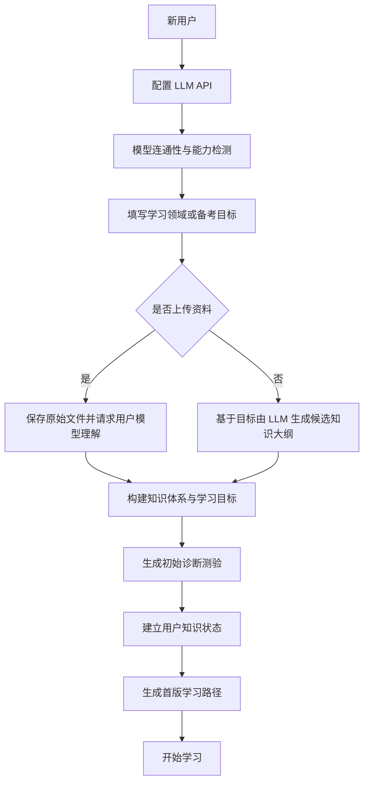
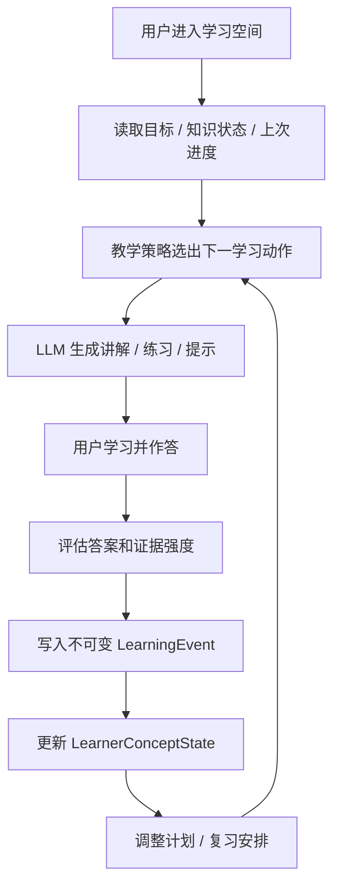
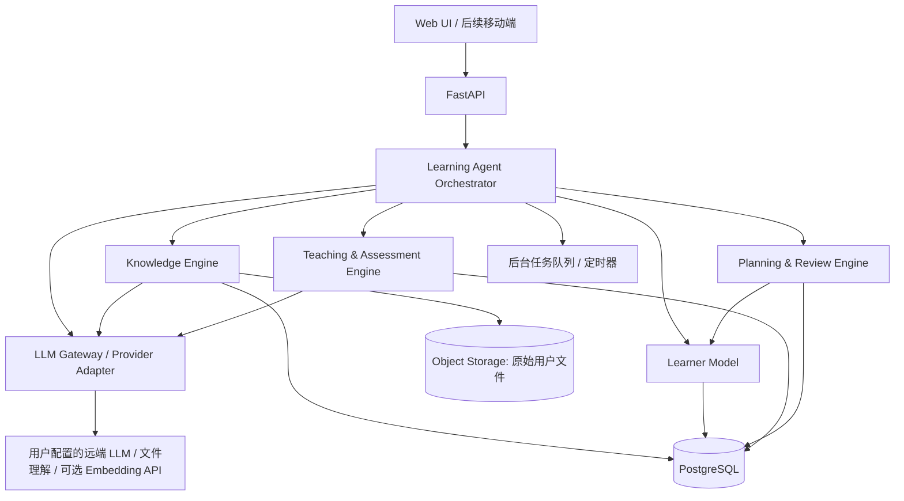
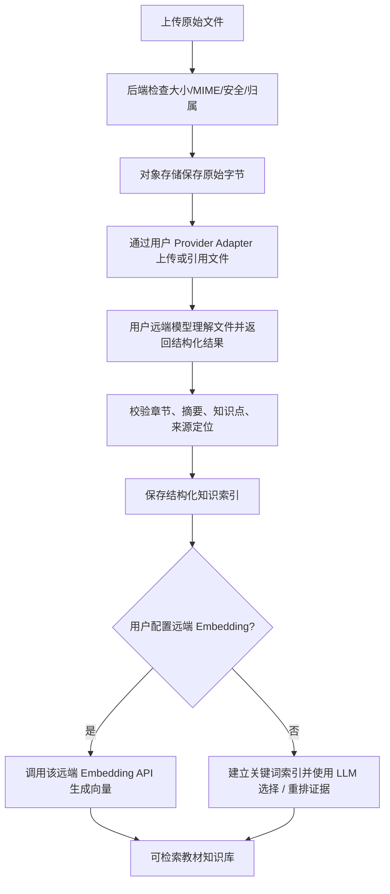

# StudyAgent Framework：通用个人学习 Agent 开发规格说明书

> **文档版本**：v1.0  
> **编写日期**：2026-10-15  
> **用途**：可直接作为 AI 编程助手（如 Codex、Claude Code 等）的项目需求说明、系统架构约束、任务拆分与验收依据。  
> **项目定位**：用户自带 LLM API（BYOK, Bring Your Own Key），自主设置学习领域或备考目标，可选上传教材；框架自动完成知识组织、能力诊断、个性化教学、学习评估、状态更新和后续学习规划。

---

## 0. 开发总原则（必须先读）

### 0.1 产品目标

构建一个**通用、可配置、可持久化、与特定模型厂商解耦的个人学习 Agent 框架**。用户无需懂 Prompt、RAG 或知识追踪算法，只需完成以下配置：

1. **LLM API 配置**：服务商／兼容接口、Base URL（可选）、API Key、聊天模型名称；如需向量检索，可额外选择该服务商支持的 Embedding 模型。
2. **学习目标配置**：学习领域、备考目标、目标日期、每日可用时长、预期水平；除“学习领域／备考目标”外，其余项可选并提供合理默认值。
3. **学习资料（可选）**：上传教材、讲义、笔记、考试大纲等，作为用户私人学习资源；不上传也可以创建学习空间。

框架承担其余工作：构建课程知识结构 → 初始能力诊断 → 生成学习路径 → 日常教学与练习 → 基于证据更新掌握状态 → 动态调整下一次学习任务。

### 0.2 **不可违反的硬性约束**

- **禁止内置本地 Embedding 模型**，不下载、不运行 Sentence Transformers、BGE、E5 等本地向量模型。
- **禁止内置本地文档内容解析/OCR 引擎**，不调用 PyMuPDF、pdfplumber、Docling、Tika、Unstructured、Tesseract、LibreOffice 或类似本地解析链路来提取 PDF／EPUB／DOCX 正文。
- **文档的内容理解、章节提取、知识点抽取、语义归纳均交由用户配置的 LLM 服务完成**；依赖该服务商的原生文件输入、文件上传 API、文档理解能力或相应云端能力。
- **Embedding 如被使用，必须调用用户自行配置并授权的远端模型 API**；若该服务商无可用 Embedding 接口，则不得暗中启动本地模型。
- 可以使用数据库、对象存储、文件元数据校验、哈希校验、关键词／全文索引、任务队列等普通基础设施；这些不等于运行本地 Embedding 或进行本地文档内容解析。
- **不能假定任意聊天 LLM 都能读取 PDF／EPUB／DOCX，也不能假定它天然提供 Embedding API**。必须在接入阶段进行能力检测，按能力启用功能；不支持时明确提示并降级或禁用，而不是伪装成功。
- **用户学习知识状态必须持久化在框架数据库中，不得仅依赖聊天上下文或模型自带记忆**。
- **每个关键教学决策都应能追溯其学习证据**，不可让模型无依据地随意覆盖知识掌握度。
- **原始用户资料和上传文件严格按用户隔离**，不得跨用户进入共享知识库；向第三方 LLM 发送资料前必须提供清晰的授权告知。

### 0.3 明确不做的事情（至少在 MVP 阶段）

不训练专用基础模型；不做本地 OCR／Embedding；不做全科目人工维护的大型题库；不以 Multi-Agent 数量作为产品价值；不保证无外部资料时生成的考试大纲是最新版；不自动购买课程、不自动发送消息、不执行未获授权的外部操作。

---

## 1. 产品使用流程

### 1.1 首次创建学习空间



### 1.2 日常学习闭环



### 1.3 必须支持的三种基础场景

| 场景 | 输入 | 框架行为 |
|---|---|---|
| 无资料、学习新领域 | “我想系统学习操作系统” | 生成**候选**知识结构、做摸底测验、创建计划；注明缺少权威教材时的内容不确定性 |
| 备考且上传教材／大纲 | “备考 408” + 用户教材 | 由用户模型解析资料，建立有来源的知识节点、生成复习任务和练习 |
| 老用户继续学习 | “继续昨天的学习” | 加载已有知识状态、未完成任务和复习需求，不从头规划 |

对于特定考试年份、政策、考纲变化，只有当用户上传了对应官方大纲，或用户模型**确实具备并已调用**可信联网资料能力时，才能标记“已核实版本”；否则标记为“模型生成、待核实”。

---

## 2. 总体系统架构

采用**一个主 Learning Agent + 若干确定性服务模块**的结构，不要在第一版实现多 Agent 互相对话。



### 2.1 模块职责和边界

| 模块 | 职责 | 禁止越界行为 |
|---|---|---|
| **LLM Gateway** | 模型调用、能力探测、结构化输出、文件输入、远端 Embedding、用量与错误处理 | 不直接修改用户知识状态 |
| **Knowledge Engine** | 学习目标分解、文档理解任务编排、知识点与依赖关系、检索与出处管理 | 不运行本地文档提取／本地 Embedding |
| **Learner Model** | 用户画像、学习行为记录、知识掌握估计、证据置信度 | 不把“看过”直接记为“学会” |
| **Teaching Engine** | 讲解、对话引导、出题、答题反馈、答案评估 | 不允许未经验证的模型评分直接写入“已掌握” |
| **Planning Engine** | 选择下一动作、前置知识检查、任务优先级、复习调度 | 不得只根据聊天摘要推断知识掌握 |
| **Orchestrator** | 流程、状态机、工具执行、异常恢复 | 不无限自主循环、不得跨用户读取数据 |

### 2.2 推荐技术栈

- **语言／API**：Python 3.12+、FastAPI、Pydantic。
- **数据库**：PostgreSQL（核心数据、事件、元数据）；可选 `pgvector` 存储**用户远端模型生成**的向量。
- **任务调度**：开发期可用轻量任务队列；生产可用 Redis + Celery 或等价方案。
- **原始文件存储**：本地受控文件目录（单机开发期）或 S3 兼容对象存储（生产）。存储文件**不代表解析文件内容**。
- **LLM 适配**：自定义 `ProviderAdapter` 接口，可选使用 LiteLLM 做通用文本调用，但涉及服务商原生文件 API 时应使用专门适配器。
- **前端**：Next.js / React（先实现 Web）。
- **测试**：pytest，数据库迁移，Mock/Fake LLM Adapter，少量可选真实 API 集成测试。

注意：不要把 `pgvector` 误认为本地 Embedding，它只是向量数据库扩展。真正的向量仍来自用户授权的远端模型。

---

## 3. LLM Gateway：用户自带 API 的模型适配

### 3.1 用户配置数据

```json
{
  "provider_type": "openai_compatible",
  "base_url": "https://api.example.com/v1",
  "chat_model": "user-selected-chat-model",
  "embedding_model": null,
  "api_key": "***只允许通过加密凭证机制保存***",
  "max_cost_per_day": 2.0,
  "currency": "USD"
}
```

API Key 永远不明文回传前端，不写日志，不放进浏览器可读取的持久存储；后端密文保存或使用专用密钥管理设施。模型费用因服务商而异，预算统计应优先使用提供商返回的使用量，并清楚区分“估算”和“实际账单”。

### 3.2 统一适配协议（逻辑接口）

```python
from typing import Protocol, Any

class ProviderAdapter(Protocol):
    async def probe_capabilities(self) -> dict[str, bool]: ...
    async def generate_text(self, messages: list[dict]) -> str: ...
    async def generate_structured(self, messages: list[dict], schema: dict) -> dict: ...
    async def analyze_file(self, file_ref: str, task: dict) -> dict: ...
    async def embed_texts(self, texts: list[str]) -> list[list[float]]: ...
```

> 以上为架构协议草案，并非要求每个适配器都实际支持全部方法。不支持某方法时，明确抛出 `CapabilityNotSupported`，不能用假的结果填充。

### 3.3 模型能力矩阵

模型连接测试时写入 `provider_capabilities`：

| 能力 | 是否必需 | 缺失时处理 |
|---|---|---|
| 普通聊天生成 | **必需** | 不允许创建学习空间 |
| 结构化 JSON 输出 | **逻辑必需**（可经提示 + 严格校验实现） | 反复校验失败时停止该任务并给出可恢复错误 |
| 原生 PDF／文件理解 | **教材功能必需** | 不允许上传此类文件后继续“假装解析成功” |
| 指定 MIME 的文件输入 | 按文件类型 | 前端只允许通过能力检测的类型；其他格式给出转换提示 |
| 远端 Embedding | 可选 | 禁用向量检索，改用关键词索引 + LLM 精排 |
| 联网检索／实时搜索 | 可选 | 不宣传自动核验最新考纲；展示来源未核验状态 |
| Tool Calling | 可选 | 使用服务端确定性流程 + 结构化 JSON，而不是依赖模型原生工具调用 |

**重要区别**：聊天 API Key 不保证可用“文档解析”或“Embedding”。如服务商要求不同模型 ID，但使用相同 API Key，可让用户补充相应模型名；不得自动切换到由框架运营方付费的模型。

### 3.4 用户隐私与安全

1. 添加自定义 `base_url` 必须防 SSRF；托管环境默认阻止指向环回、链路本地、内网和云元数据地址。自托管环境允许管理员显式放宽。
2. 每次教材上传前提示：文件内容会被发送给用户选择的第三方模型提供商，并说明可能的文件保留机制。
3. 远端调用需要超时、重试次数限制、速率限制、取消能力和错误分类。
4. 需要防止上传教材中嵌入的恶意指令被当作系统命令执行；教材内容始终作为低信任资料。
5. 支持密钥更新、撤销、删除及模型切换；换模型后不删除学习历史。

---

## 4. Knowledge Engine：有／无教材时的处理机制

### 4.1 无教材：LLM 生成候选学习知识结构

处理流程：

1. 将用户目标规范化为 `DomainGoal`，包含领域、范围、目标层级、截止时间和可用时长。
2. 请求用户 LLM 生成**候选课程大纲**：模块 → 知识点 → 前置关系 → 学习目标 → 建议测评方式。
3. 使用服务端 JSON Schema 校验；检查概念唯一性、前置关系无环（DAG）、孤立节点、逻辑层级。
4. 生成知识点的 `source_status = model_generated_unverified`；若用户确认范围或后来上传资料，可逐步核验／调整。
5. 不得自动断言“符合某年官方考试大纲”。

### 4.2 有教材：仅使用用户模型提供的文件理解能力

处理流程：



**绝对不要在服务器端实现 PDF 文本提取、OCR、DOCX XML 解包提取或 EPUB 解包抽取文本。** 服务端仅处理原始文件存储与访问权限，并校验远端模型返回的结构化结果。

建议模型输出：

```json
{
  "document_id": "doc_001",
  "title": "用户教材",
  "sections": [
    {
      "section_id": "s_01",
      "heading": "第1章 操作系统概述",
      "summary": "...",
      "keywords": ["操作系统", "系统调用"],
      "concepts": ["操作系统基本概念", "系统调用"],
      "locator": {"chapter": "1", "page": null},
      "locator_verified": false
    }
  ]
}
```

LLM 生成的页码**不能自动视为可靠引文**：若 API 不提供可回查页码／文件定位，标记 `locator_verified=false`，界面只展示章节定位或“出处待核实”。

### 4.3 超长文件、格式差异与降级

- 优先选用提供商支持的**文件上传 / file_id 引用 / 文档理解** API，而不是把整本书塞进聊天上下文。
- 如果提供商支持远端文件检索工具，可通过适配器调用；该能力仍必须使用用户自己的凭证与授权。
- 超长文档采用“先远端提取目录和分章节概览 → 按章节发起模型理解任务 → 保存结构化摘要与概念”的分阶段流程；不得宣称一次输入可处理无限长度。
- 若服务商不支持原始 PDF，就禁用 PDF 教材入口，提供“更换兼容模型”或“用户手动粘贴已提取文本”的选择；不能私下调用本地解析库。
- 如果没有 Embedding API，可以通过 LLM 生成章节标题、术语、关键词并用数据库检索，然后由用户 LLM 选择相关片段；这是**非向量检索**，应明确标记。
- 书籍扫描件需要服务商原生视觉／OCR 类能力；如果没有则明确提示不支持。
- 异步处理过程需要进度、失败原因、幂等重试、删除与重新索引能力。

### 4.4 知识图谱（不要第一版引入图数据库）

用 PostgreSQL 的 `knowledge_concepts` + `concept_prerequisites` 维护知识点和依赖边即可。只有当图谱规模和查询性能确有需要时才考虑图数据库。

```json
{
  "concept_id": "os_deadlock",
  "name": "死锁",
  "learning_objectives": ["解释必要条件", "判断死锁风险", "应用银行家算法"],
  "prerequisites": ["process_synchronization", "resource_allocation"],
  "sources": [{"document_id": "doc_001", "section_id": "s_07"}],
  "source_status": "user_material_derived"
}
```

---

## 5. Learner Model：画像、状态与证据体系

### 5.1 四类画像

| 画像 | 内容 | 获取方式 | 更新触发 |
|---|---|---|---|
| 目标画像 | 学习领域、考试日期、目标能力、每日时长 | 用户填报 + 主动确认 | 用户修改目标 |
| 知识画像 | 每个知识点的掌握状态、证据、不确定性 | 测验、作业、实践、复习 | 每个有效证据事件 |
| 行为画像 | 学习时段、完成率、连续性、停滞点 | 平台行为日志 | 行为事件累计 |
| 教学偏好 | 喜欢示例、推导、练习、反馈方式 | 用户选择 + 显式反馈 | 偏好确认或调整 |

**不要仅凭用户自称“我会”就判定为 Mastered；也不要根据用户没有学习记录就判定为“不懂”。**

### 5.2 最小知识状态

```json
{
  "user_id": "u_001",
  "study_space_id": "sp_001",
  "concept_id": "os_deadlock",
  "status": "learning",
  "mastery_estimate": 0.55,
  "evidence_count": 5,
  "independent_correct_count": 2,
  "evidence_confidence": "medium",
  "last_assessed_at": "2026-10-15T10:00:00Z",
  "misconceptions": ["混淆死锁预防与死锁避免"],
  "estimator_version": "rules_v1"
}
```

`mastery_estimate` 是算法估计而非客观成绩；若证据不足，应显示 `unknown` 或宽泛区间，不强行展示精确百分比。

### 5.3 Learning Event：所有推断的依据

```json
{
  "event_id": "evt_001",
  "study_space_id": "sp_001",
  "type": "assessment_submitted",
  "concept_ids": ["os_deadlock"],
  "assessment_item_id": "item_001",
  "is_correct": true,
  "assistance_level": "none",
  "evaluator": "deterministic_answer_key",
  "occurred_at": "2026-10-15T10:00:00Z",
  "payload": {"attempt_no": 1, "duration_seconds": 75}
}
```

事件类型至少包含 `diagnostic_submitted`、`lesson_viewed`、`hint_requested`、`assessment_submitted`、`practice_completed`、`review_submitted`、`plan_adjusted`。事件必须绑定用户和学习空间，支持去重 ID 和时间戳，允许后续按新算法重放估计。

### 5.4 能力测评和状态更新原则

- **阅读 / 点击完成**：只记录学习经历，不直接认定掌握。
- **独立答题**：可以成为掌握证据；记录题目难度、知识点映射、作答方式和是否使用提示。
- **依靠提示答对**：视为辅助完成，不能与独立正确同权重。
- **开放式回答**：用户 LLM 可进行评分，但需要统一评分标准、结构化评价和“不确定”出口。
- **程序题**：若以后提供代码沙箱，以确定性测试为主要证据；没提供沙箱前，不得把 LLM 口头判断当作运行结果。
- **多知识点综合题**：不能因为一题错误，便把全部关联知识点判定为不掌握；可追加单知识点诊断。
- **遗忘**：不因若干天未登录就简单清零，复习状态与知识掌握状态分开处理。

### 5.5 第一版规则引擎（后续可替换）

首期采用可解释规则，示例：

- `unknown`：尚无有效、可归因的测评证据。
- `learning`：存在证据但尚不满足掌握门槛；包括薄弱、改善中、证据矛盾。
- `mastered`：对某知识点已在**至少两次不同题目／情境下独立表现达标**，且达到配置的难度要求。
- 低置信度状态优先追加诊断；评估规则变更时记录 `estimator_version`，可重算而不覆盖原事件。

上述门槛只是 MVP 可调整规则，不是经过教育测量校准的普遍标准。阶段三再引入 BKT / 更严格的校准。

---

## 6. Learning Policy：如何决定“下一步学什么”

不要让 LLM 直接从完整聊天历史随意决定课程进度。由框架先综合用户状态和知识依赖产生候选学习动作，再交给 LLM 完成教学内容。

### 6.1 下一步动作类型

```text
DIAGNOSE          诊断未知能力
LEARN_CONCEPT     学习新知识
REMEDIATE         补齐前置知识或修复误区
PRACTICE          针对性练习
REVIEW            间隔复习
ASSESS            阶段测验
PROJECT           综合应用任务（后续）
```

### 6.2 可解释的策略选择

核心依据：学习目标优先级、前置关系、当前掌握状态、证据不确定性、复习到期情况、剩余学习时间、目标日期。初期使用确定性打分或优先级规则，记录每次选择原因。

```python
def choose_next_action(state, curriculum, available_minutes):
    if state.has_critical_unknowns():
        return {"action": "DIAGNOSE", "reason": "关键知识缺少可靠证据"}
    if state.has_due_review():
        return {"action": "REVIEW", "reason": "存在待复习内容"}
    if state.has_missing_prerequisites(curriculum):
        return {"action": "REMEDIATE", "reason": "目标知识的前置条件未满足"}
    if state.has_weak_concepts():
        return {"action": "PRACTICE", "reason": "已有薄弱知识点"}
    return {"action": "LEARN_CONCEPT", "reason": "可以进入新知识"}
```

> 仅为策略示例。真实算法应避免 `has_critical_unknowns()` 永久抢占，采用有限诊断预算和候选任务评分；不可在同一个回合无限自循环。

### 6.3 教学 Agent 的响应结构

```json
{
  "selected_action": "PRACTICE",
  "concept_ids": ["os_deadlock"],
  "reason": "用户理解基本概念，但尚不能独立使用银行家算法",
  "lesson": "...",
  "exercises": [{"question": "...", "grading_rubric": "..."}],
  "estimated_minutes": 20,
  "requires_followup_assessment": true
}
```

用户看得到自然语言讲解，数据库保存结构化学习动作和选择原因。

---

## 7. 核心数据模型与 API 合约

### 7.1 PostgreSQL 关键数据表

| 表名 | 核心字段 / 作用 |
|---|---|
| `users` | 用户账号、时区、偏好与删除状态 |
| `provider_configs` | 服务商、模型、能力矩阵、加密凭证引用、用量限制 |
| `study_spaces` | 用户、学习目标、截止日期、课程状态、当前计划 |
| `material_assets` | 文件所有者、MIME、大小、存储地址、远端 file_id、解析状态 |
| `material_sections` | LLM 返回的章节、摘要、关键词、证据定位、可信性 |
| `knowledge_concepts` | 学习空间所属的知识点、目标、来源状态 |
| `concept_prerequisites` | 知识点之间的前置依赖边 |
| `assessment_items` | 题目、题型、知识点映射、难度、标准答案或评分准则 |
| `assessment_attempts` | 作答、提示次数、评估结果、评估模型版本 |
| `learning_events` | 只追加的学习行为事件，按用户隔离 |
| `learner_concept_states` | 当前知识状态、掌握估计、证据置信度和版本 |
| `learning_plans` | 阶段计划、每日任务、生成依据、状态 |
| `review_schedules` | 复习到期时间、复习历史、调度模型参数 |
| `agent_runs` | Agent 执行步骤、错误、模型费用、可追溯信息 |
| `notification_preferences` | 用户授权的提醒渠道、时间段与频率（第四阶段） |

必须在服务端所有查询中限制 `user_id`／`study_space_id` 归属；数据库外键、唯一约束、索引和迁移必须写全。学习事件建议 append-only，通过事务确保“保存评估 → 更新状态 → 保存计划”一致或可重试。

### 7.2 REST API（首版约定）

```text
POST   /api/v1/providers                 新增模型配置
POST   /api/v1/providers/{id}/test       连通性和能力检测
GET    /api/v1/providers/{id}/capabilities

POST   /api/v1/study-spaces              创建学习空间
GET    /api/v1/study-spaces/{id}         查看学习空间
GET    /api/v1/study-spaces/{id}/concepts
GET    /api/v1/study-spaces/{id}/profile

POST   /api/v1/study-spaces/{id}/diagnostics
POST   /api/v1/study-spaces/{id}/attempts
GET    /api/v1/study-spaces/{id}/next-action
POST   /api/v1/study-spaces/{id}/lessons/{lesson_id}/complete
GET    /api/v1/study-spaces/{id}/plan
GET    /api/v1/study-spaces/{id}/events

POST   /api/v1/study-spaces/{id}/materials            （阶段二）
GET    /api/v1/study-spaces/{id}/materials/{asset_id} （阶段二）
DELETE /api/v1/study-spaces/{id}/materials/{asset_id} （阶段二）

GET    /api/v1/study-spaces/{id}/reviews              （阶段三）
POST   /api/v1/study-spaces/{id}/reviews/{rid}/submit（阶段三）

PUT    /api/v1/study-spaces/{id}/notifications        （阶段四）
```

API 路径只是约定草案；可在编码前调整一次，但之后应生成 OpenAPI 并与前端和测试保持一致。对异步动作返回任务 ID，提供 `GET /api/v1/jobs/{id}` 查询状态。

---

## 8. **四阶段开发计划（AI 开发必须按序实施）**

> 优先级原则：**每个阶段必须可运行、可测试、可演示、可回滚**，不允许一次性完成四阶段后才测试。

### 阶段一：最小学习闭环（MVP / P0）

**目标**：只使用用户提供的聊天 LLM API，不要求教材、Embedding、文件解析能力，完成“目标 → 诊断 → 教学 → 测验 → 状态更新 → 下一步推荐”。

**开发任务**

- [ ] 创建 FastAPI 后端、PostgreSQL、迁移、环境变量模板、开发用 Web UI。
- [ ] 完成用户鉴权、学习空间隔离、基本错误与请求日志（日志须脱敏）。
- [ ] 实现 LLM Provider Adapter，至少支持一种 OpenAI-compatible 聊天端点；配置 API Key、Base URL、模型名、超时；增加模型连接测试。
- [ ] 实现 `generate_structured` + JSON Schema 校验 + 有界重试；失败不可写入不完整课程数据。
- [ ] 用户创建学习空间，填写学习领域／备考目标、可选学习时间／期限。
- [ ] 请求用户 LLM 生成候选课程树和知识点前置关系，服务端验证无环和来源状态。
- [ ] 由 LLM 生成初始诊断题；有标准答案的题使用确定性判分优先。
- [ ] 定义 `LearningEvent`、`LearnerConceptState`、`LearningPlan`；实现初版规则状态更新。
- [ ] 实现“下一学习动作”的确定性决策逻辑与可解释理由。
- [ ] 实现完整课堂会话：获取任务、LLM 教学、学生作答、批改、更新状态。
- [ ] 保存学习进度；退出并重新登录后继续，不丢失状态。
- [ ] 使用 Fake LLM Adapter 构建端到端测试，无真实付费 Key 也能运行测试。

**阶段一演示脚本**

1. 用户配置一个可用的 LLM API，输入“我要学习操作系统”。
2. 框架自动生成知识结构，推送 5～10 道诊断题。
3. 用户独立答题，系统记录掌握状态与证据。
4. Agent 推荐一个薄弱知识点，完成 1 次讲解 + 1 次练习。
5. 答对／答错将产生不同状态更新及下一动作。
6. 关闭页面再进入，目标、状态、计划与历史事件保持一致。
7. 切换到另一个兼容模型配置后，学习状态不丢失。

**验收标准（全部通过才能进入阶段二）**

- [ ] 能跑通上面 7 步，所有状态可从数据库独立查出。
- [ ] 用户没作答时，不能凭 LLM“感觉”把知识点改为已掌握。
- [ ] 同一事件重放不会重复加分（幂等）。
- [ ] 错误 API Key、API 超时、非法结构化返回有明确错误，不破坏状态。
- [ ] 两个不同用户不能互相访问学习空间、事件或模型凭证。
- [ ] 阶段一**不依赖任何本地 Embedding 或文档解析工具**。

**交付物**：可运行的基础框架、数据库迁移、OpenAPI 文档、README、一键启动脚本、单元与端到端测试、MVP 演示数据。

### 阶段二：个人教材与知识库（P1）

**目标**：用户可以上传自己的学习资料，框架通过**其自行配置的 LLM 文件理解 API**提取知识并参与教学检索。

**开发任务**

- [ ] 扩展 Provider Adapter：文件类型能力探测、远端文件上传／引用、远端模型结构化内容理解。
- [ ] 文件上传接口：MIME／大小限制、恶意文件风险校验、哈希、鉴权、对象存储与生命周期管理。
- [ ] 无远端文件理解能力时前端禁用不支持的上传类型并明确解释原因。
- [ ] 用户模型按目录 → 章节 → 概念／摘要进行分阶段文档理解；任务状态可追踪。
- [ ] 校验模型返回结构，标记章节／页码定位是否可信；原始文件及章节索引可删除。
- [ ] 实现“来源优先”检索：先检索用户提供的教材证据，再根据用户授权决定是否允许通用知识补充。
- [ ] 可选接入**用户配置的远端 Embedding API**；在可用时对远端提取的章节／文本生成向量并写入 pgvector。
- [ ] 没有远端 Embedding API 时，用章节、关键词、数据库检索 + 用户 LLM 重排；明确不使用本地模型。
- [ ] 支持重新上传、处理失败重试、模型变更重新索引、资料删除和数据隔离。
- [ ] 教学和测验输出能显示真实可回查的章节证据；定位不可靠时不得伪造页码。

**验收标准**

- [ ] 能成功处理至少一份**模型服务明确支持**的样例教材；明确展示章节和知识点。
- [ ] 不支持文件输入的模型应返回可理解的能力错误，不能假装成功。
- [ ] 启用和不启用远端 Embedding 都可完成适合其能力的教材搜索流程。
- [ ] 任一检索结果能关联来源文件；未经核实的页码不呈现为可靠引用。
- [ ] 删除教材后，新检索不能访问已删除的索引／原文；按提供商能力执行远端文件清理或向用户提示其保留策略。
- [ ] 依赖检查和运行日志中均不出现本地 PDF/EPUB/DOCX 正文提取或本地 Embedding 调用。

**交付物**：教材上传页面、文件适配器、文档理解任务、检索服务、引用 UI、资料删除与权限测试。

### 阶段三：学习者建模与自适应提升（P1）

**目标**：从简单规则转向**有校准依据的知识状态估计与动态学习路径**，提高下一任务推荐的有效性。

本阶段按用户于 2026-10-19 确认的[开源 BKT＋FSRS 设计](docs/superpowers/specs/2026-10-19-m3-open-source-bkt-fsrs-design.md)实施，所有空间必启两个算法并移除旧规则回退。以下为工程实现／回归验收状态；真实教育效果尚未验证，详细结果见[验收记录](docs/acceptance.md)。

**开发任务**

- [x] 整理题目—知识点 Q-Matrix，区分独立、提示辅助和多知识点综合测评。
- [x] 引入完整 pyBKT（Bayesian Knowledge Tracing），所有空间统一启用；按用户确认移除旧规则估计器，不设置回退。
- [x] 给掌握估计增加模型版本、输入证据窗口和预测置信指标；为参数留出拟合／校准接口。
- [x] 引入完整开源 py-fsrs／FSRS-6 间隔复习策略，将记忆保持／复习到期与技能掌握分开存储。
- [x] 推荐算法综合知识依赖、目标权重、掌握估计、不确定性和复习时间，不以单一正确率排序。
- [x] 建立教学模式：首次学习、误区修复、定向练习、迁移测试、阶段评估。
- [x] 完成用户画像与学习报告：能力分布、近期进步、证据数量、易错点、下一步理由。
- [x] 增加模型质量评估：下一题表现预测、误判率、复习后保持率、任务完成率。
- [x] 数据不足时使用保守策略，优先诊断；不能展示“虚假的高精度百分比”。

**验收标准**

- [x] 同一批固定学习事件可按版本化 BKT 参数重建状态，FSRS 通过原生日志重调度，不丢原始证据。
- [x] 不同作答模式（独立答对／提示下答对／独立答错）产生合理且可解释的估计差异。
- [x] 关键前置知识不足时，不会直接推荐依赖它的高难任务。
- [x] 复习到期可以影响学习顺序，但不会把长期未登录直接等价为零掌握。
- [x] 使用一套固定的、版本化的回归数据集评测更新前后质量，不仅依赖个别演示案例。

**交付物**：原生 BKT 版本化估计器、复习调度、推荐策略、学习报告、评测数据集和对比结果。

### 阶段四：主动式个人学习 Agent（P2）

**当前确认范围（2026-10-19）**：按用户要求取消新增提醒设置、授权与数据控制模块，加入独立登录／注册页面与严格账号隔离。后台只使用现有数据；LLM 分析由用户点击触发。既有登录、退出和空间删除保留。

- [x] 持久周期队列、账号时区与夏令时，幂等、租约、三次重试、死信及执行面板。
- [x] 每日结合目标／截止日期／BKT／FSRS／先修条件安排任务，最多6项且不超预算；超额复习保留待安排。
- [x] 中断／积压／超期建议可接受或跳过；只调整待办，不伪造学习证据、不改FSRS日期。
- [x] 站内消息、未读与来源导航，重复周期不重复通知；不接外部通知渠道。
- [x] 自然周持久总结、本周预览、基于完整周净进步的谨慎预测；不足数据说明原因，保留7／30天报告。
- [x] 用户显式AI分析，跨空间账号UTC日配额、完整请求预留、真实／未知用量展示，失败只手动重试。
- [x] `/login`／`/register`独立路由；所有新实体具备用户空间复合约束，Web／CLI共享后端，旧账号响应失效。
- [x] 删除／维护工具认识新表；空间清除正文、保留账号无正文用量，迟到结果不能复活数据。验收不操作真实学习库。

工程验收与部署边界见 [M4指南](docs/m4-active-learning.md)及[验收记录](docs/acceptance.md)。真实BYOK内容质量、学习效果、Docker与pgvector继续保留原阶段的待验收状态，不以本机工程测试替代。

**交付物**：任务调度、每日任务、偏离建议、站内消息、自然周报、手动分析、运行面板、登录注册与CLI入口。完整行为依据[已确认设计](docs/superpowers/specs/2026-10-19-m4-active-learning-design.md)。

---

## 9. 推荐仓库结构

```text
study-agent/
├── backend/
│   ├── app/
│   │   ├── api/                  # REST API / 鉴权 / 权限
│   │   ├── core/
│   │   │   ├── orchestrator.py
│   │   │   ├── settings.py
│   │   │   └── security.py
│   │   ├── providers/
│   │   │   ├── base.py          # 用户模型服务统一协议
│   │   │   ├── compatible.py    # OpenAI-compatible 文本能力
│   │   │   ├── capabilities.py
│   │   │   └── files/           # 云端原生文件功能的适配器
│   │   ├── knowledge/
│   │   │   ├── curriculum.py
│   │   │   ├── material_tasks.py# 只编排远端 LLM 文件理解
│   │   │   ├── concept_graph.py
│   │   │   └── retrieval.py
│   │   ├── learner/
│   │   │   ├── profile.py
│   │   │   ├── events.py
│   │   │   └── estimators/      # rules_v1 / bkt_v1
│   │   ├── teaching/
│   │   │   ├── lessons.py
│   │   │   ├── questions.py
│   │   │   └── grading.py
│   │   ├── planning/
│   │   │   ├── policy.py
│   │   │   └── review.py
│   │   ├── jobs/                # 文档云端处理 / 提醒调度
│   │   ├── db/                  # ORM / repository / migration
│   │   └── schemas/             # 严格 Pydantic 输入输出模式
│   ├── tests/
│   │   ├── unit/
│   │   ├── integration/
│   │   └── e2e/
│   └── pyproject.toml
├── frontend/
├── docs/
│   ├── architecture.md
│   ├── api.md
│   ├── security.md
│   └── development-roadmap.md
├── docker-compose.yml
├── .env.example
└── README.md
```

在后端依赖规范中明确：**不得引入本地文档提取、OCR 或本地 Embedding 依赖**。若为元数据检查使用通用 MIME 检测工具，应仅用于文件格式／安全校验，不得调用它提取教材正文。

---

## 10. AI 编程助手执行约定

### 10.1 推荐逐阶段实现指令

将本文件放在仓库根目录，向 AI 编程工具提供以下任务描述：

> 你是 StudyAgent Framework 的主开发工程师。请完整阅读 `StudyAgent_Framework_Development_Spec.md`。严格遵守第 0.2 节的硬性约束，**不准实现或引入本地 Embedding、PDF／EPUB／DOCX 内容解析或 OCR**。目前只执行**阶段一**，不要提前实现阶段二到四。先输出简短任务拆分和数据库模型，然后在现有仓库直接编码、补充测试与 README。所有 LLM 调用走 Provider Adapter，使用 Fake Adapter 使测试无需真实 API Key。每完成一个可运行子任务即运行测试；最后按“阶段一验收标准”逐项给出通过／未通过与证据。任何不支持的模型能力应显式报错，不允许编造数据。

进入下一阶段时只需把“阶段一”替换为“阶段二／三／四”，并要求先验证之前阶段的回归测试。

### 10.2 代码质量守则

1. **接口优先**：先定义 `ProviderAdapter`、`LearningEvent`、`LearnerConceptState`、`LearningAction`、`KnowledgeConcept` 等稳定边界。
2. **结构化输出必检验**：所有课程树、知识点、题目、评分、状态建议经过 Schema 和业务规则校验。
3. **状态更新在服务端**：LLM 可提供“评分证据／误区解释”，不能自由调用数据库更新自己的评估结论。
4. **可重试、可恢复**：任务具有幂等键，已完成的学习事件不可重复计分。
5. **测试驱动**：优先编写领域逻辑单测、权限测试、Fake LLM 集成测试，再接真实 API。
6. **信息可信边界**：LLM 的课程大纲、教材定位、考试年份和评分都有来源／置信标记；严禁伪造考试权威性。
7. **最小化依赖**：阶段一不引入消息队列、向量库、图数据库或复杂多 Agent 机制，除非有清晰必要性。
8. **文档同步**：新增接口、数据表、状态机、配置项、错误码时，同步更新 README / OpenAPI / migrations。
9. **可观察性**：记录 `run_id`、`study_space_id`、模型 ID、耗时、token 用量／费用估计、错误类型，但不记录 API Key、个人教材全文或敏感答案。
10. **安全默认关闭**：未获得用户授权时，文件不外传给第三方服务，后台不主动进行外部付费调用。

### 10.3 必须覆盖的自动化测试

| 测试类别 | 关键用例 |
|---|---|
| LLM 接入 | 成功、Key 无效、超时、限流、结构化输出非法、模型切换 |
| 学习空间 | 正常创建、字段缺失、重复初始化、重启恢复 |
| 知识图谱 | 重复知识点、缺失前置节点、循环依赖、来源状态 |
| 评估与状态 | 未答题不加分、提示下答对弱证据、独立答对、答错、事件重放幂等 |
| 学习策略 | 关键未知先诊断、薄弱点练习、前置不满足不越级、有限诊断预算 |
| 多用户隔离 | 用户 A 不可访问用户 B 的教材、模型配置、题目历史和学习状态 |
| 文档能力（阶段二） | 文件 API 不支持时明确拒绝、云端解析失败可恢复、删除后检索不可见 |
| 定时任务（阶段四） | 未授权不通知、任务幂等、时区、免打扰、停用生效 |

---

## 11. 功能边界、风险和取舍

### 11.1 用户自带模型策略带来的限制

- **不是所有 LLM 都具备文件理解能力**。因此阶段二的实际文件支持取决于所连接服务商；UI 必须显示“该模型支持哪些文件格式”。
- **不是所有 LLM 提供 Embedding**。Embedding 可以为零；不影响阶段一基本学习闭环。阶段二可降级为关键词与 LLM 选证据，但搜索质量、成本和速度可能较差。
- **文件解析、复杂教学和批量出题可能产生较高 API 成本**。必须设置异步任务数量、token 限额、取消能力和预算提示。
- **上传的书可能超出上下文／文件处理限制**。不能承诺任意文件都能完整消化；应提示处理范围、失败章节和证据覆盖率。
- **LLM 可能产生错误知识、错误引文或不稳定评分**。需要对外展示未核实标识，测评使用标准答案优先，开放式答案提供置信度或二次核验流程。
- **不同提供商对文件与数据的保留政策不同**。框架删除自己的文件不一定意味着第三方同步删除；在支持远端删除时尝试删除，否则明确说明。

### 11.2 MVP 最重要的三项验证指标

1. **状态连续性**：用户隔天重新进入后，系统是否准确继承上一次学习状态和任务。
2. **能力估计有效性**：系统估计的知识薄弱点是否和后续独立答题表现吻合。
3. **教学价值**：使用个性化学习路径与非个性化固定路径相比，延迟测验成绩、任务完成率是否改善。

仅有“对话流畅”“生成课件漂亮”不足以证明这是有效的学习 Agent。

---

## 12. 阶段完成清单（项目总验收）

| 里程碑 | 用户可见成果 | 必须证明的核心能力 |
|---|---|---|
| **M1：学习闭环** | 配置模型 → 输入目标 → 测评 → 学习 → 下一步 | 有状态、可持续、可解释的学习流程 |
| **M2：私人教材** | 上传支持的文件 → 生成章节知识 → 教材引用教学 | 所有文件理解与 Embedding（如有）都来自用户模型服务 |
| **M3：智能自适应** | 知识能力报告、弱点强化、复习安排 | 根据真实证据动态更新、可回放和可校准 |
| **M4：主动陪伴** | 每日任务、偏离建议、站内消息、周报与目标追踪、账号隔离 | 后台零LLM、调度可靠、手动分析费用可控；新提醒／授权控制模块取消 |

### 最终产品架构原则

```text
StudyAgent =
    用户目标（Goal）
  + 领域知识结构（Curriculum）
  + 持久化学习者状态（Learner State）
  + 可解释教学策略（Learning Policy）
  + 用户自带模型能力（BYOK LLM Gateway）
  + 教学与评估执行（Learning & Assessment Runtime）
```

**框架的价值不在于拥有某个更大的模型，而在于：通过持续保存可追溯的学习证据，了解用户目前会什么、还缺什么，并自动选择下一步最有效的学习行动。**

**强制开发顺序：M1 → M2 → M3 → M4。任何阶段验收不通过，不得把后续阶段标记为完成。**
