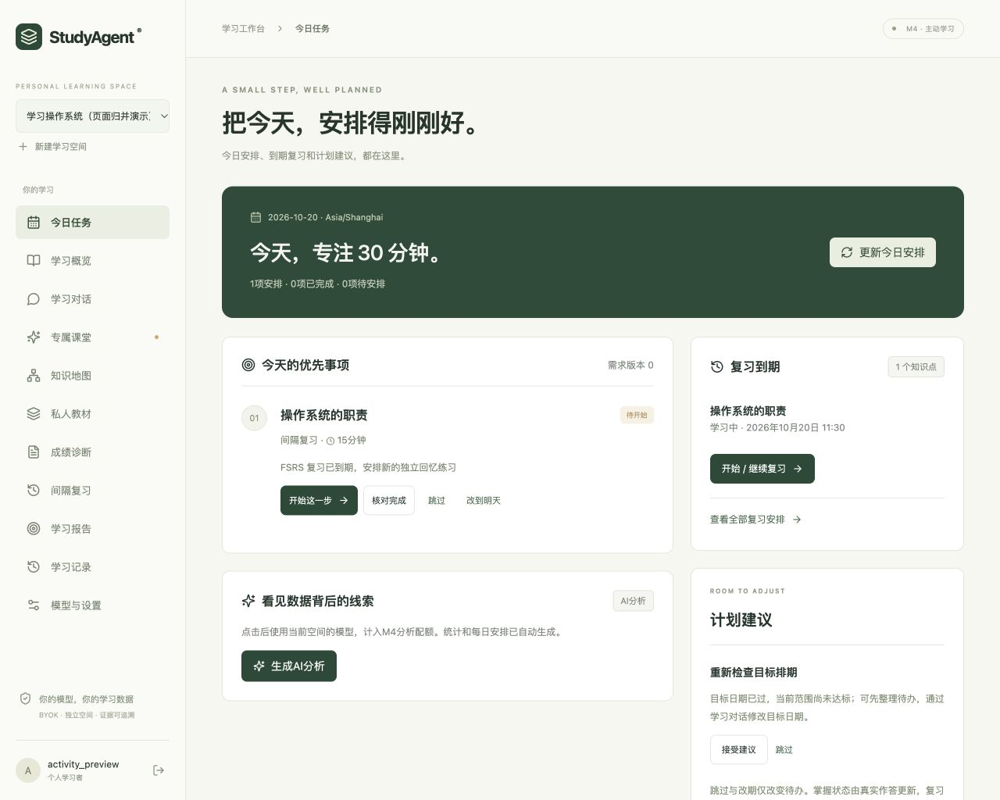
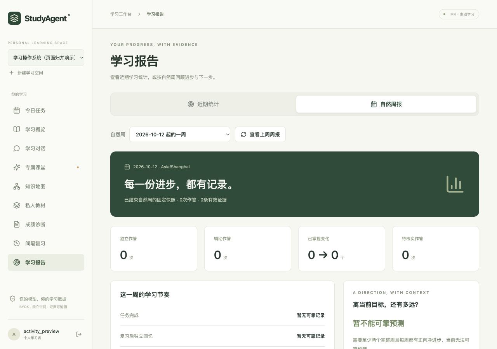
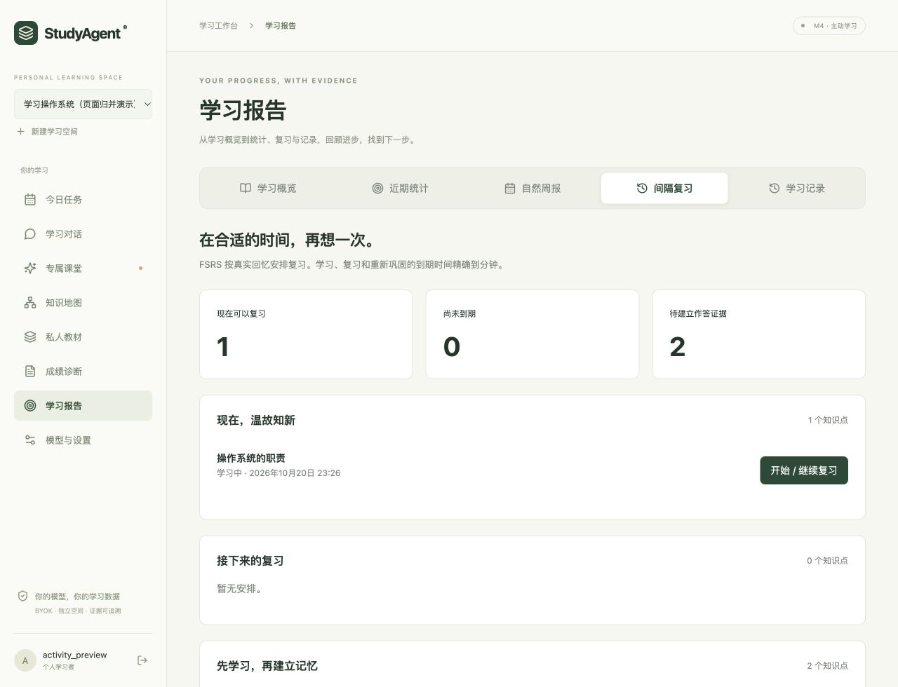
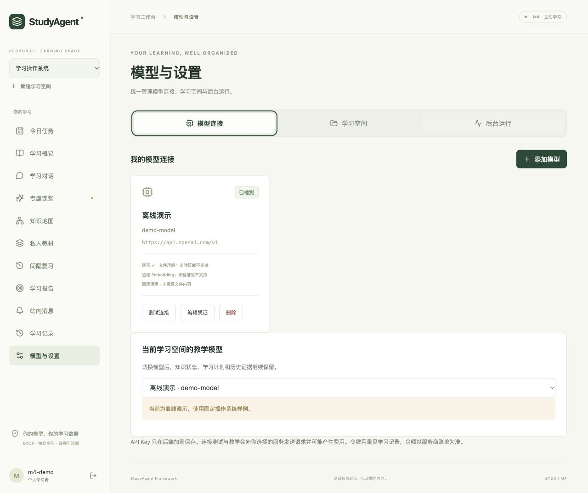

# 每日任务、周报与 AI 分析

每日任务与自然周报根据已有学习数据生成，AI 解读由用户手动触发。学习记录按账号与空间隔离；不发送邮件、短信或系统推送。

## 使用方式

1. 运行 `./scripts/serve.sh`，访问 `/login` 或 `/register`。已有账号可直接登录；各账号的空间、模型、教材、答题、学习对话、任务和报告相互隔离。
2. 创建或选择学习空间，打开「今日任务」。后台启动即扫描，此后默认每60秒协调；也可点击「更新今日安排」。GET 只读取，不暗中生成或调用模型。
3. 从任务进入原有诊断／课堂／复习。重复开始恢复同一执行，不重复生成。完成状态要求真实关联题全部作答，课堂还需阅读；手动核对不能代替证据。
4. 跳过、改到明天只改待办；不改 BKT 证据或 FSRS 到期日。跨天继续中的任务保留原身份，改期新安排保留来源。
5. 在「今日任务」查看到期复习与计划建议，可直接开始／继续复习、查看全部复习安排，或接受／跳过建议；没有今日计划时也可查看。「学习概要」包含学习概览、近期统计、自然周报、间隔复习与学习记录五个同级标签：概览保留下一步与学习入口，近期统计保留原7／30天报告，自然周报提供本周预览与历史周报，间隔复习提供到期与后续复习安排，学习记录保留时间线和模型调用用量。
6. 需要模型解释时点击「生成AI分析」。这一步才调用空间模型；建议以纯文本呈现，不直接改计划。更改学习需求仍使用「学习对话」。
7. 「模型与设置 → 后台运行」可查看本人所有空间的周期任务、失败原因、死信重试、分析历史和分析配额。CLI 对应命令见[CLI指南](cli.md)。

[查看手机布局](assets/activity-today-mobile.png)

截图来自独立临时库与显式离线演示模型；到期复习和已过目标日期为合成演示场景，不是用户真实学习记录。

## 页面导航

相关内容按使用目的归入今日任务、学习概要与模型设置：

| 侧栏入口 | 页内标签 | 内容 |
|---|---|---|
| 今日任务 | 同页分区 | 今日安排、到期复习、计划建议 |
| 模型与设置 | 模型连接 | 模型配置、能力检测、编辑凭证、当前空间教学模型 |
| 模型与设置 | 学习空间 | 学习空间管理、新建、进入学习与原有删除／清理状态 |
| 模型与设置 | 后台运行 | 周期任务、手动分析历史及账号配额 |
| 学习概要 | 学习概览 | 当前目标、知识掌握概览、下一步与继续学习 |
| 学习概要 | 近期统计 | 滚动7／30天报告 |
| 学习概要 | 自然周报 | 本周预览、历史自然周与手动AI分析 |
| 学习概要 | 间隔复习 | 到期复习、后续安排、待建立作答证据与开始／继续复习 |
| 学习概要 | 学习记录 | 学习事件时间线与模型调用记录 |

今日任务的「查看全部复习安排」定位到「学习概要 → 间隔复习」。登录、点击品牌或切换空间后进入学习概览。标签支持方向键、Home／End 与 Tab 键，手机端可横向滑动；只加载当前标签的内容。

[查看学习记录](assets/report-history-desktop.png) · [查看手机复习布局](assets/report-reviews-mobile.png)

[查看手机布局](assets/settings-tabs-mobile.jpg)。截图使用独立演示账号，没有修改真实学习记录。

## 每日与每周规则

每日最多主动安排6项，预算不超过空间每日分钟数；先继续活动课堂，再结合 BKT、FSRS、当前需求范围、先修条件和截止日期安排。超预算／先修不足复习保留在待安排列表，不假装已经纳入今天。完成与跳过记录保留。

中断至少3个当地日期、历史任务积压或到期复习超预算、已过截止日期或可估速度超过目标日期时，提出可接受／跳过的建议。旧需求版本不能覆盖新对话调整。同类消息按周期去重，重复协调不重置已读。

自然周为账号时区周一00:00至下周一00:00，区间为左闭右开；处理夏令时。无效时区回退 Asia/Shanghai 并提示。周报保存固定快照；首次后台仅补最近一个完整周，不连续补发全部历史周。

预测按近28天完整周净增加的已掌握概念数估算。至少两个完整周且各周均为正增长才给日期范围；停滞、回退、数据不足会明确显示无法可靠预测。比率保留分子／分母，无分母时显示暂无记录。任务完成分母为本周开始任务加本周完成的跨周任务，完成与跳过按实际发生周归属；改期历史只将未解决任务链末端计入积压。预测样本从统计截止点之前28个当地日期内的完整自然周选择，本周预览与历史周报使用同一规则；预测不代表通过概率或完成保证。

## 后台可靠性与费用

- `periodic_jobs` 持久保存周期、状态、代次与租约；重启可恢复。三次尝试，失败退避30／120秒，最后死信，支持本人主动重试。
- 后台仅统计已有数据，**不调用LLM**；教材处理仍是已有独立 worker，可能按其授权调用文件模型。
- 手动 AI 分析准备→远端调用→发布分阶段；等待期间释放数据库锁。发布重验会话、空间、租约、模型配置与来源版本，失效时不发布正文。
- 默认每账号每UTC日10次分析、100000 Token，跨空间共享；输出上限1500。按完整实际请求UTF-8字节数＋输出上限预留，输入大小上限48000字节。
- 服务商报告可靠 usage 后按实际结算；超时／usage缺失保留保守占用，不按零退款。重复请求键复用结果；失败重试必须由用户新发起，重新占用一次额度，关闭内部自动网络／结构修复重试。
- 只管理手动 AI 分析，不涵盖原有教学、教材与学习对话全部费用。未配置价格，货币费用显示不可用；服务商违反上限或少报 usage 时无法承诺账单绝对上限。
- 删除空间移除队列、任务、消息、建议、周报和分析正文；账号日累计用量保留，不能靠删空间恢复额度。迟到执行不能复活内容。

## 配置与升级

常规 `./scripts/serve.sh` 自动执行增量数据库迁移，**不清空学习记录**。升级前备份数据库、资料目录与加密密钥，并停止旧版本服务。

| 环境变量 | 默认值 | 含义 |
|---|---:|---|
| `M4_WORKER_ENABLED` | `true` | 启用本进程周期协调 |
| `M4_TICK_SECONDS` | `60` | 扫描间隔秒数 |
| `M4_ANALYSIS_DAILY_CALL_LIMIT` | `10` | 本账号UTC日分析尝试上限 |
| `M4_ANALYSIS_DAILY_TOKEN_LIMIT` | `100000` | 分析Token占用上限 |
| `M4_ANALYSIS_MAX_OUTPUT_TOKENS` | `1500` | 单次分析输出上限 |
| `M4_ANALYSIS_MAX_INPUT_BYTES` | `48000` | 完整分析输入请求大小上限 |

SQLite 用于单进程本地部署；多副本使用 PostgreSQL、共享教材存储与共享限流。新实体使用用户／空间复合外键，API依据会话推导归属，跨账号404、未登录401。登录与注册支持直达、刷新、密码确认和浏览器前进后退；换号／换空间的旧响应无法覆盖当前页面。

## 运行检查

`./scripts/check.sh` 运行静态检查、SQLite回归、前端行为测试与生产构建。`.venv/bin/python scripts/check_postgres.py` 默认仅创建并清理临时本地实例（需已安装的可选pgserver）；不会继承已有 `TEST_DATABASE_URL`。若明确使用隔离测试数据库，可加 `--use-test-database`，各测试创建并删除独立schema。

工程检查使用隔离测试数据和协议替身。真实模型内容质量、教育效果与部署兼容性需要单独验证。
