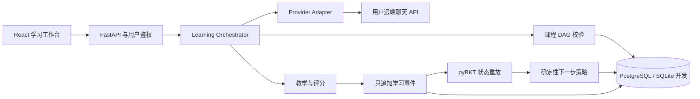

# M1 / M2 / M3 架构与数据库

此实现遵循原规格第 10.1 节，按顺序实现 M1、M2、M3。一个确定性 Orchestrator 协调模块，不创建模型间对话。

## 稳定边界

CLI（`backend/app/cli`）是与 Web 并列的 HTTP 客户端。命令入口 `study-agent`；本地仅保存按服务端点隔离的受限权限会话与空间选择，模型凭证仍只在后端加密保存。命令不会越过 API 直接读写知识状态。CLI 使用细节见 `docs/cli.md`。

`ProviderAdapter` 提供文本、严格 JSON、能力探测和明确拒绝的文件 / Embedding 方法。网关不能直接更新学习状态。所有课程、题目、讲解、提示与开放评分先经过 Pydantic / JSON Schema，再经过 DAG、知识点归属和题目唯一性检查。

教学模型调用同步等待返回，事务在完整校验后保存。M2 新增数据库持久队列，用户授权的资料任务在后台分步运行；各远端步骤有界并记录检查点。调用失败保留脱敏 AgentRun；索引原子发布，课程、题目与状态不留半成品。

## 数据表

| 表 | 作用与主要约束 |
|---|---|
| users | 用户名唯一；scrypt 密码摘要与时区 |
| auth_sessions | SHA-256 会话令牌摘要与过期时间；HttpOnly Cookie |
| provider_configs | 所有者、模型、Fernet 密文凭证、能力检测状态 |
| study_spaces | 所有者、目标、每日时长、日期；用户内初始化幂等键唯一；复合外键限制模型所有者 |
| knowledge_concepts | 空间内唯一知识点 key；初始来源 model_generated_unverified，教材可补充 user_material_derived，删除后保留 source_removed_unverified |
| concept_prerequisites | 空间内概念 / 前置概念复合外键，禁止跨空间依赖 |
| assessment_items | 题目内容与答案；空间内题干哈希唯一；课堂归属复合外键 |
| assessment_attempts | 答案、评分、评估器、请求指纹；同题仅一条有效作答；幂等键唯一 |
| lessons | 讲解、动作理由、阅读状态；空间内创建键唯一 |
| learning_events | 用户 / 空间复合外键，幂等键唯一；数据库触发器拒绝 UPDATE / DELETE |
| learner_concept_states | 空间 / 概念复合主键和外键；状态、证据、算法版本、UTC 测评时间 |
| learning_plans | 下一动作、理由、证据 ID、目标日期、每日任务 |
| agent_runs | run_id、模型、空间、步骤、耗时、token 用量、错误码；不保存完整输入输出 |

## 测评事务与重放

提交幂等键相同且请求指纹相同则返回原结果；同键异内容或同题另开提交返回 409。确定性选择题判分优先。服务端检查历史提示事件并提升 assistance_level，客户端无法隐藏提示。

一笔事务完成：作答事件 → 重放原生 BKT 状态、更新原生 FSRS 卡片与日志 → 保存下一计划 → plan_adjusted 事件 → 保存作答结果。失败全部回滚。事件不保存敏感答案全文，只保留作答引用、判分和证据属性；答案在鉴权控制的 attempts 表。

PostgreSQL 对用户行加锁串行化同一用户的写操作，同时使用唯一约束防重复。SQLite 以应用内写锁配合数据库约束，仅支持单进程开发；部署多 worker 必须切 PostgreSQL。

观测规范只接受高置信、可归因证据；以题目 ID 去重。不同模型版本可通过 `profile/rebuild` 重新计算当前 BKT 状态，原事件不变。事件与状态中的时间统一为 UTC，避免数据库会话时区影响重放。

策略先过滤所有前置未满足的知识点，再按目标重要性、可用时长排序。最多五次初始诊断作答优先级，之后进入基础学习，避免永久诊断循环。复习 / 遗忘模型属于 M3。

## M2 文件、任务与检索

- `material_assets`：用户/空间复合外键、原始文件元数据、哈希、上传幂等指纹、索引代次、原服务商指纹、待清理远端句柄；不复制旧密钥。
- `material_sections`：远端摘要、关键词与概念、未经核实的章节定位、可选远端向量 JSON；空间/资料复合外键。
- `material_jobs`：持久 queued/running/succeeded/failed/cancelled 状态、租约、尝试次数、分步检查点、错误类型；本人与空间内请求键唯一。
- 可选 `material_vectors`：由 scripts/pgvector.sql 初始化，存放远端向量的 pgvector 镜像；与章节外键级联删除。

原文仅作为私有字节对象保存。Files + Responses 适配器通过真实随机 PDF 探测，仅支持已验证 MIME。后台 worker 原子领取任务，分步“上传→目录→章节→可选远端向量→发布”；每步后验证代次与租约，最终发布在同一事务按 asset→job 锁序校验，删除／取消不能被旧任务覆盖。迟到上传句柄重新建立清理任务，失败墓碑仍可发现与重试。

检索限定本人、空间与 ready 资料，关键词／远端向量产生候选，用户模型只可从候选 ID 精排。新的诊断与课堂先取资料证据，默认证据不足停止；通用补充需空间显式授权。模型返回的引用经白名单与存活来源校验，读取时再次过滤已删除来源。概念来源可补充，但不生成作答证据；新概念同时初始化 BKT 未观测状态与 FSRS 未学习卡片，不将上传当作学习证据。

默认单实例 worker；SQLite 仅用于单进程开发。多副本应使用 PostgreSQL、共享资料存储与共享限流。当前租约提供崩溃恢复，远端上传请求在未收到响应时可能存在无法确认的远端保留，需遵循服务商政策核对。M3、M4 已实现；边界见各阶段验收记录。

## M3 算法与事务

`learner/evidence.py` 负责可靠性、去重、辅助类别，`learner/bkt.py` 调用 pyBKT 原生前向推断；CPU 计算放在线程池，ORM Session 留在请求线程。`reviews/fsrs_adapter.py` 调用原生 Card／Scheduler／ReviewLog；知识状态与记忆状态分表保存。`teaching/attempts.py` 是普通答题与复习的共同入口，事件、BKT、FSRS 日志、尝试和计划同事务提交，失败整体回滚。每用户写锁、事件唯一日志与幂等摘要共同防止重复计分。

0004 增加 ReviewState、ReviewSession、ReviewLogRecord、MaintenanceOperation 与空间算法元数据；外键绑定用户、空间、概念、课堂和题目。原事件与原生日志留存，参数升级通过显式维护命令重建派生状态。常规启动和迁移不执行学习数据清空。离线训练环境独立，在线服务不训练。

## 学习计划聊天

`chat/service.py` 将一次回合分为准备、模型、发布三个阶段。准备／发布由线程内自有Session和短事务执行，远端等待期间释放用户锁与SQLite应用写锁；发布重验会话、用户／空间归属、认领token／租约、需求／课程／模型基线。

ChatTurn负责回合身份与状态，LearningIntent保存版本化需求／路线，PlanRevision保存差异。`planning/intent.py`投影需求范围及必要前置；policy_v3把用户重点作为独立分项，继续结合BKT／FSRS与前置硬约束。动态重排不会覆盖路线。`chat/application.py`同事务保存新需求、原生空观测新节点、修订、事件、计划和回合结果。

Lesson.status的active／paused与completed区分。当前课堂优先读取未完成活动课堂，暂存复习释放活动概念占位，不制造作答或重调度。登出数据库撤销在线程完成，避免等待短发布锁时阻塞ASGI；只有聊天短事务持有AuthSession行锁，长教学调用沿用用户锁而不持有该会话锁。

## M4 主动学习

`activity/` 管理日周时区边界、纯数据快照、每日协调、建议与消息、周报、配额及手动分析。0006新增PeriodicJob／DailyPlan／DailyTask／LearningSuggestion／InboxMessage／WeeklySummary／AnalysisRun／AnalysisDailyUsage。用户空间复合外键与统一User→Space→业务对象锁序保护归属与并发；空间删除共用服务按依赖顺序清理，账号用量聚合保留。

lifespan管理独立M4循环，默认60秒扫描，只有 daily_coordinate／weekly_summary 两种无模型处理器；短数据库阶段在线程内建立自己的Session，远端分析等待释放锁。PostgreSQL使用行锁与SKIP LOCKED，SQLite只支持单实例应用锁。租约校验、周期唯一键、三次尝试／退避／死信和同事务消息防止重复发布。手动分析单独准备／调用／发布，不被自动重试。

前端AuthPage分离登录注册；会话代次过滤迟到401；任务／周报以用户与空间为key重建请求作用域，资源代次与稳定请求键防止串号和重复提交。CLI映射同一组HTTP接口，不在本地重算计划。详见[M4指南](m4-active-learning.md)。

## 已批改试卷诊断

`exam_diagnostics` 独立管理 manifest 草稿、私有附件、规范化题目、持久任务、诊断报告与外部证据。用户模型适配器提供 PDF／图片独立探测和多输入识别，服务端重算统计并约束知识点归属。worker 通过短事务认领、阶段检查点与 token fencing 恢复；远端调用在事务之外。报告、逐题事件、BKT 重放和计划同事务发布。外部事件与在线 ASSESSMENTS 分开，显式禁止生成 FSRS 回忆日志。清理保留最小加密服务商快照并接入空间永久删除与维护清空。
