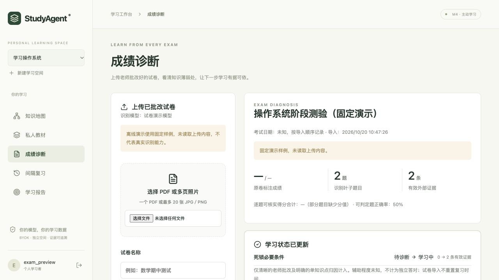

# 已批改试卷成绩诊断

在学习空间侧栏打开「成绩诊断」，上传老师批改后的试卷。识别和诊断使用该空间当前配置的用户模型，框架只负责校验、统计和学习记录更新，不执行本地 OCR。

## 使用

1. 在「模型与设置」完成能力检测。JPG／PNG 可使用 OpenAI-compatible 聊天与图片接口；PDF 使用原生 Files + Responses 接口。图像理解与 PDF 文件理解分别显示检测结果，聊天可用不代表可以识别试卷；旧连接或更新过配置的连接应重新检测。
2. 在「成绩诊断」选择一个 PDF，或一组 JPG／PNG 照片。可调整照片顺序，填写试卷名称和可选的考试日期。
3. 勾选本次远端处理授权，点击「上传并诊断」。原卷保存在服务端私有目录，处理交给你的服务商，可能产生费用；保留政策由服务商决定。
4. 后台完成后，在历史记录中查看诊断。离开页面或重启服务不会丢失已经保存的任务；失败可重试。

默认单文件 20 MiB、整卷 40 MiB、最多 20 张照片，单边 8192 像素、单张 3200 万像素，最多识别 200 个叶子题目。实际限制以页面显示为准；`EXAM_MAX_BYTES` 与教材限制取较小值。首版不混传 PDF 和照片，不支持 HEIC、WebP、压缩包或外部文件链接。

## 报告和学习状态

报告保留题号、题干、学生答案、老师勾叉／批注和可见得分，展示正确、错误、部分正确、未作答及待核对。统计由服务端重算；原卷总分与逐题加总不符时同时显示，缺分保持未知。题目覆盖不完整时不会提供整卷正确率。PDF 页码属于模型提供的信息，未经本地核验。

模型还会给出薄弱知识点和巩固建议；建议需要结合原题核实，不能仅凭失分判断“粗心”等心理原因。报告的系统下一步读取实际更新后的学习计划。

只有批改清晰、识别和知识映射均为高置信度、完整正确或错误且对应单个已有知识点的题目，才更新 BKT 知识状态。部分得分、模糊标记、没有现有知识点或多知识归因不明的综合题仍进入报告，但不直接生成二元掌握证据。明确小问可独立计入。

导入试卷的辅助程度为「未知」，不增加独立答对或独立掌握资格。它可以改变掌握估计、薄弱点和下一步安排，但不生成 FSRS 回忆日志，不重置复习到期时间，也不代替今天在线答题或每日任务完成。学习报告单独展示按导入时间统计的外部试卷证据。

填写考试日期后，作答按该日期插入历史重放；未知日期按导入顺序记录并明确标注。日期不能晚于今天。

## 核对与重复上传

在未计入证据的题目下展开「核对这道题」。可以修正结果、分值和当前空间知识映射；原始识别仍保留。原批改清晰、只是知识映射待核对的题目可补入一次证据；手工改对错不会把原本模糊的批改升级为可靠证据。已入库题目首版只读。

同一空间内，实际文件字节相同的整卷重复上传、改文件名或重排同一组照片，会返回已有诊断，不重复计入证据。重新拍照、扫描或重新编码会产生不同文件，无法保证识别为同一张试卷，请避免重复导入。

诊断历史中每条记录都有删除按钮，确认后删除报告和本地附件，停止该记录的后续处理，并清理远端文件。删除已完成报告会撤回其导入的学习证据，重算 BKT 知识状态与学习计划；在线答题证据和 FSRS 复习安排保持不变。原始学习事件按追加式审计规则保留，通过删除事件将该诊断排除出有效证据与统计。删除后可重新上传相同试卷。永久删除学习空间会清除该空间的全部本地原卷、报告及学习记录，并尝试清理远端文件；服务商保留政策仍以其规则为准。

## 模型、后台和恢复

图片按连接类型使用 Chat Completions 的 `image_url` 或 Responses 的 `input_image`，保留原始图片字节，以 Base64 data URL 发送。PNG、JPEG 各用随机标识图片独立探测，只有正确读出图片内容才开放对应格式；失败会显示原因，不直接判定模型没有视觉能力。仅接收公开图片 URL 的服务商可能无法通过本地上传图片的检测，框架不会自动把私有图片发布到公网。原生 PDF 的既有教材能力与限制不变。

模型调用不持有数据库写事务；识别、分析和发布之间保存检查点。分析或发布失败后可以恢复，已经成功的识别不必重新运行。切换服务商或模型配置后，需要重新授权并重做相关阶段；报告读取、历史轮询不调用模型。远端引用按上传时的加密服务商快照清理，防止配置切换把删除请求发往新服务商。

诊断各阶段的 HTTP 请求与阶段总时限统一使用 `EXAM_CALL_TIMEOUT_SECONDS`（默认 120 秒），不会再被普通聊天连接的 30 秒设置提前中断。DeepSeek 官方 Flash 接口在试卷识别与建议生成时显式关闭额外思考，避免默认高强度思考增加提取任务的等待；其他连接不附加该厂商参数。超时提示包含失败阶段，调用记录保存实际处理时长。

兼容接口接受裸 JSON 或单个完整的 JSON Markdown 代码块，解析后仍执行相同的 schema 与业务校验；不会从解释文字中随意截取 JSON，也不会保存截断或不合法的识别结果。

配置：`EXAM_WORKER_ENABLED=true`；`EXAM_MAX_BYTES=20971520`（最多 64 MiB）；`EXAM_MAX_IMAGES=20`；`EXAM_MAX_QUESTIONS=200`；`EXAM_JOB_ATTEMPTS=3`；`EXAM_MAX_OUTPUT_TOKENS=32000`；`EXAM_CALL_TIMEOUT_SECONDS=120`。最终支持的上下文与输出上限仍取决于用户模型，超限或输出不完整会明确失败。

## 验证范围

工程验收使用隔离数据库、原生协议替身和明确标注的固定演示样例，覆盖上传、校验、报告、知识状态更新、重复请求、历史日期、失败恢复、账号隔离与删除。演示不读取试卷内容，也不证明真实识别准确率或教育效果；真实手写、扫描质量、老师批改风格、费用和延迟需用所选 BYOK 模型验收。

## 页面预览

[390px 手机报告预览](assets/exam-diagnostics-mobile.png)。截图来自隔离演示账号和固定样例，未使用真实试卷识别。
